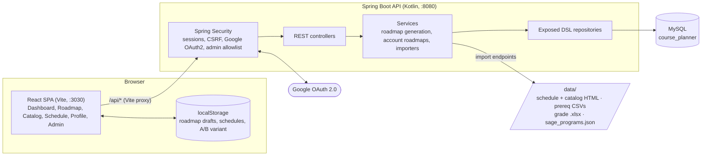
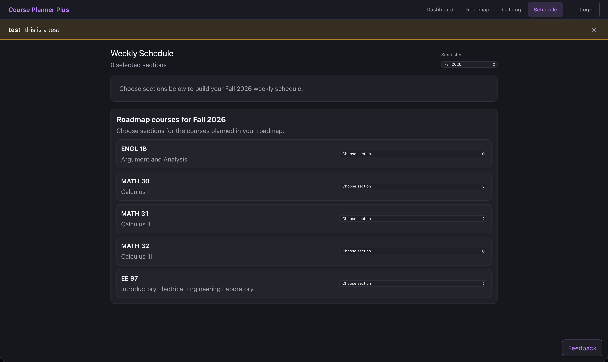
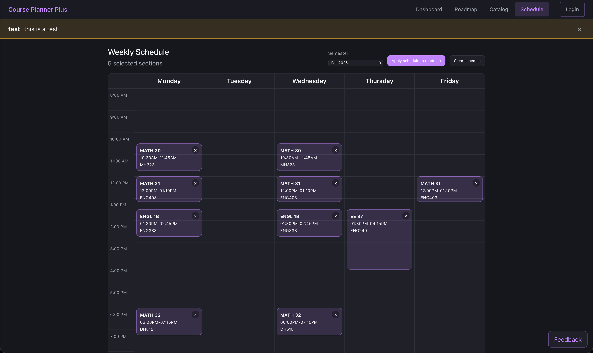
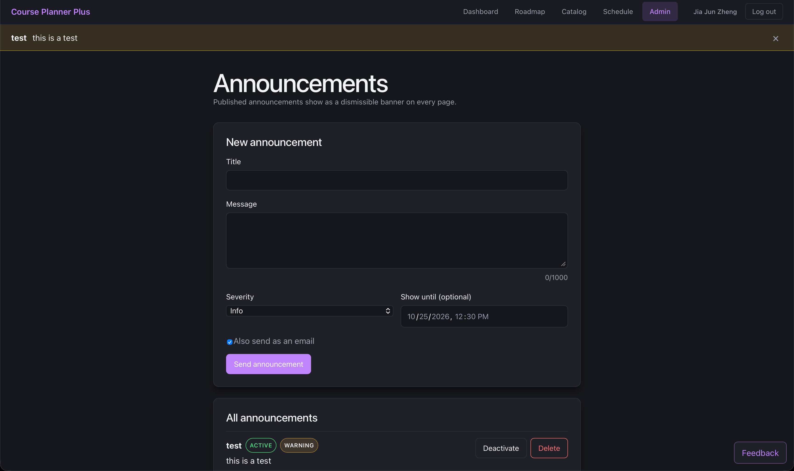
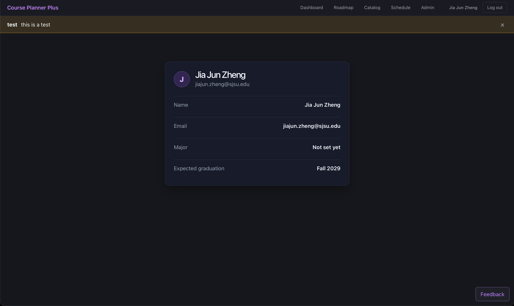

# Course Planner Plus

## Team

| Name   | GitHub                                     | Email                 |
|--------|--------------------------------------------|-----------------------|
| Dayven | [@daylenh](https://github.com/daylenh)     | dayven.lenh@sjsu.edu  |
| Mita   | [@miiiyyi](https://github.com/miiiyyi)     | mita.yang@sjsu.edu    |
| Jiajun | [@smol-derp](https://github.com/smol-derp) | jiajun.zheng@sjsu.edu |
| Yunfei | [@ychen1026](https://github.com/ychen1026) | yunfei.chen@sjsu.edu  |

**Advisor:** Carlos Rojas

---

## Project Description

SJSU students plan their degrees across disconnected tools (MyPlanner, MyProgress, MyScheduler). They don't validate prerequisites, show how major and GE requirements fit in, or let a student simulate failed courses or gap semesters. Course Planner Plus combines all of this in one web app: an interactive drag-and-drop roadmap with prerequisite arrows and warnings, a course catalog with sections and historical grade distributions, and a weekly scheduler.

---

## Prototype Scope

### What works end to end

All of the features below go through the React frontend, the Spring Boot API and MySQL. They use SJSU data for the Computer Engineering and Software Engineering BS majors and the Spring 2026 and Fall 2026 terms.

- **Accounts:** email/password sign-up and login, or Google sign-in. Sessions are cookie-based and CSRF-protected.
- **Dashboard:**
  - Pick a major and see progress and requirements.
  - GE area progress (completed, planned and missing areas). This covers areas only.
  - SAGE / 4+1 accelerated master's options.
- **Interactive roadmap (`/roadmap`):** a semester-by-semester plan drawn as a node graph.
  - **Editing:** drag courses between semesters, add any course in the database (filter by subject, then course number), remove courses, and add or remove semesters (including gap semesters).
  - **Prerequisite arrows:** prerequisite and corequisite arrows, with a Hide/Show Arrows toggle. Clicking a course highlights it and the courses one arrow away.
  - **Course status:** planned, in progress, completed or failed. Marking a course failed marks every later course that depends on it as blocked.
  - **Warnings:** warning badges and a validation panel for missing prerequisites or corequisites.
  - **Notes:** a note on any course.
- **Roadmap saving:**
  - Every edit is kept in the browser per major.
  - Signed-in users can save the roadmap to their account.
  - When a signed-in user opens the roadmap and their account already has a saved one, a dialog asks to keep the device's version, load the account's, or replace the account's version.
- **Catalog (`/catalog`):** search a term's courses and filter by subject. Each course shows its sections, instructors, GE areas, a Rate My Professors search link and a grade-distribution bar chart (2023–2025, per course and per instructor). Adding a section opens the scheduler.
- **Schedule (`/schedule`):** a weekly calendar of the chosen sections with time-conflict checks. Leaving with unapplied courses asks you to apply or discard them.
- **Profile:** expected graduation term, taken from the last roadmap semester.
- **Admin announcements:** admins publish, deactivate and delete site-wide banners (info, warning or critical, with an optional expiry).
- **A/B test of the roadmap save UX:** each browser is randomly given one of two variants, one with auto save and one that gives a warning about saving. Add `?variant=warning` or `?variant=autosave` to any URL to choose one. The choice sticks for that browser. The Feedback button opens that variant's form.

- **Mobile layout** with hamburger navigation. Dark mode follows the OS setting.

### What is incomplete

- Courses from outside the major have no prerequisite checks. Currently we're having issues with scraping the SJSU site due to firewalls so there needs to be lots of manual edits.
- The `autosave` variant never saves to the account. It saves in the browser only.
- Data coverage: only two majors and two terms are imported.
- Admin "Also send as an email" checkbox: it does nothing and is visual currently.

---

## System Architecture



- **Frontend (`frontend/`):** a React single-page app.
  - `src/api/*` calls `/api/...` through the Vite proxy. `src/lib/authApi.js` handles login, sign-up, admin and account-save calls with cookies and a CSRF token.
  - Roadmap state is a reducer in `RoadmapContext`, persisted by `roadmapStorage.js`. Prerequisite validation and the fail cascade run in the browser.
- **Backend (`backend/`):** Kotlin Spring Boot REST API. Controllers sit on top of services which call repositories that use JetBrains Exposed. The schema is created on startup from `PlannerSchemaTables.kt`.
- **Database:** MySQL `course_planner`, holding courses, sections, instructors, majors and requirements, prerequisites, GE areas, grade distributions, SAGE programs, users, saved roadmaps and announcements.
- **Data pipeline:** one-time import endpoints read the files in `data/`:
  - saved SJSU schedule pages (sections and GE areas)
  - saved catalog pages (major requirements)
  - prerequisite CSVs (made by Dayven)
  - SJSU grade-distribution spreadsheet
  - a SAGE program list

<details>
<summary>API reference</summary>

| Method   | Endpoint                                        | Description                                                                                           |
|----------|-------------------------------------------------|-------------------------------------------------------------------------------------------------------|
| GET      | `/api/health`                                   | Health check: `{"status":"ok"}`                                                                       |
| GET      | `/api/db`                                       | Database connectivity check                                                                           |
| POST     | `/api/auth/register` · `/login` · `/logout`     | Email/password accounts                                                                               |
| GET      | `/api/auth/me`                                  | Signed-in user, or `401`                                                                              |
| GET      | `/api/auth/csrf`                                | Issue the `XSRF-TOKEN` cookie                                                                         |
| GET      | `/api/roadmaps/majors`                          | Majors that have imported requirements                                                                |
| GET      | `/api/roadmaps/majors/{majorId}`                | Default roadmap: semesters, courses, prerequisites and their source text, requirements, SAGE programs |
| GET      | `/api/roadmaps/me`                              | Signed-in user's saved roadmap (`404` if none)                                                        |
| PUT      | `/api/roadmaps/me`                              | Save the signed-in user's roadmap                                                                     |
| GET      | `/api/catalog/terms`                            | Terms whose sections haven't ended                                                                    |
| GET      | `/api/catalog/courses`                          | Catalog courses with GE areas (optional `?term=`)                                                     |
| GET      | `/api/grade-distributions/course`               | Grade distribution (`?courseNumber=CMPE 120`)                                                         |
| GET      | `/api/sections`                                 | Persisted sections (optional `?term=`)                                                                |
| GET      | `/api/schedule-data/full-schedule`              | All course offerings (optional `?term=`)                                                              |
| GET      | `/api/schedule-data/departments/{dept}/courses` | Courses for one department                                                                            |
| GET      | `/api/catalog-programs/supported`               | Major import keys (`cmpe`, `swe`)                                                                     |
| POST     | `/api/catalog-programs/import`                  | Import a major (`?program=cmpe` or `swe`)                                                             |
| POST     | `/api/catalog-programs/import-prerequisites`    | Import prerequisite CSVs (`?program=cmpe`, `swe` or `all`)                                            |
| GET      | `/api/scrape/import`                            | Import a term's sections (`?term=Spring 2026` or `Fall 2026`)                                         |
| GET      | `/api/scrape/test` · `/debug` · `/export`       | Preview, debug or CSV-export a parsed schedule (`?term=`)                                             |
| POST     | `/api/grade-distributions/import`               | Upload the grade spreadsheet (multipart `file`)                                                       |
| POST     | `/api/sage/seed`                                | Seed SAGE / 4+1 programs                                                                              |
| GET      | `/api/announcements/active`                     | Active banners (public)                                                                               |
| GET/POST | `/api/admin/announcements`                      | List or create announcements (admin)                                                                  |
| POST     | `/api/admin/announcements/{id}/deactivate`      | Take an announcement down (admin)                                                                     |
| DELETE   | `/api/admin/announcements/{id}`                 | Delete an announcement (admin)                                                                        |

Signed-out calls to protected endpoints get `401`, and non-admin calls to `/api/admin/**` get `403`. Errors come back as `{"message": "..."}`.

</details>

<details>
<summary>Project structure</summary>

```
group-project-team-10/
├── backend/src/main/kotlin/edu/sjsu/courseplanner/backend/
│   ├── controller/      # REST controllers
│   ├── service/         # roadmap generation, account roadmaps, scrapers and importers
│   ├── repository/      # Exposed tables (PlannerSchemaTables.kt) and repositories
│   ├── dto/             # request/response DTOs
│   └── config/          # security, CORS, OAuth2, schema init, admin allowlist, error handler
├── frontend/src/
│   ├── pages/           # Dashboard, Roadmap, Catalog, Schedule, Login, Signup, Profile, Admin
│   ├── components/      # Layout, CourseNode, CourseCard, AnnouncementBanner, LeaveConfirmModal, ...
│   ├── context/         # Auth, Roadmap (+ roadmapStorage), Schedule
│   ├── api/, lib/      # fetch helpers; authApi.js (session/CSRF), experiment.js (A/B variant)
│   └── utils/           # prerequisiteValidator, roadmapEdges
├── data/                # import sources (schedules, major_requirements/, prereq/, grades, SAGE)
├── docs/                # database schema, screenshots
└── .github/workflows/   # CI
```

</details>

---

## Prerequisites

| Software      | Version              | Notes                                                                         |
|---------------|----------------------|-------------------------------------------------------------------------------|
| Git           | any recent           |                                                                               |
| JDK           | **21**               | e.g. Temurin 21. The Gradle 9.3.1 wrapper is included, so Gradle isn't needed |
| Node.js + npm | **20.19+** or 22.12+ | required by Vite 8                                                            |
| MySQL Server  | **8.0+**             | local, default port `3306`                                                    |
| curl          | any                  | for loading data                                                              |

- **Accounts:** a Google Cloud account, needed only for "Sign in with Google". Email/password login needs nothing external.
- **Hardware:** any laptop.

---

## Installation

Run every command from the **repository root** unless a step says otherwise.

**1. Clone the repository and install the frontend dependencies**

```bash
git clone https://github.com/SJSU-CMPE-195/group-project-team-10.git
cd group-project-team-10
cd frontend && npm install && cd ..
```

Backend dependencies download on the first `./gradlew` run.

**2. Create the database**

```bash
mysql -u root -p -e "CREATE DATABASE course_planner;"
```

The backend creates all tables on startup. No SQL scripts are needed.

**3. (Optional) Set up Google sign-in.** In [Google Cloud Console → Credentials](https://console.cloud.google.com/apis/credentials), create an OAuth 2.0 Client ID (Web application) with the redirect URI `http://localhost:8080/login/oauth2/code/google`. Without it the app works, and only Google sign-in fails.

**4. Set environment variables** in the shell that will run the backend:

| Variable               | Required           | Purpose                                                                                   |
|------------------------|--------------------|-------------------------------------------------------------------------------------------|
| `DB_USERNAME`          | **yes**            | MySQL user for `course_planner`                                                           |
| `DB_PASSWORD`          | **yes**            | User's password                                                                           |
| `GOOGLE_CLIENT_ID`     | for Google sign-in | OAuth 2.0 client ID                                                                       |
| `GOOGLE_CLIENT_SECRET` | for Google sign-in | OAuth 2.0 client secret                                                                   |
| `ADMIN_EMAILS`         | no                 | Comma separated admin emails. Include the email you'll sign up with to see the admin page |

```bash
export DB_USERNAME=... DB_PASSWORD=... ADMIN_EMAILS=...    # Windows PowerShell: $env:DB_USERNAME="..."
export GOOGLE_CLIENT_ID=... GOOGLE_CLIENT_SECRET=...       # optional
```

**5. Start the backend** from `backend/` (see [Running the Prototype](#running-the-prototype), step 1). The importers find `data/` relative to that folder.

**6. Load the data.** A fresh database is empty, and the dashboard lists no majors until this is done. From the repo root, run these in order:

```bash
# Majors and degree requirements
curl -X POST 'http://localhost:8080/api/catalog-programs/import?program=cmpe'
curl -X POST 'http://localhost:8080/api/catalog-programs/import?program=swe'

# Prerequisites and corequisites (after the majors)
curl -X POST 'http://localhost:8080/api/catalog-programs/import-prerequisites?program=cmpe'
curl -X POST 'http://localhost:8080/api/catalog-programs/import-prerequisites?program=swe'

# Class sections and GE areas
curl 'http://localhost:8080/api/scrape/import?term=Spring%202026'
curl 'http://localhost:8080/api/scrape/import?term=Fall%202026'

# Grade distributions
curl -X POST -F 'file=@data/2023-2025 Grade Distribution Data.xlsx' \
  'http://localhost:8080/api/grade-distributions/import'

# SAGE / 4+1 programs (after the majors)
curl -X POST 'http://localhost:8080/api/sage/seed'
```

Each command returns a JSON summary, and every command is safe to re-run. Two ordering rules:

- Importing a major deletes its courses' prerequisites, so after re-importing a major you re-run the prerequisite import.
- The SAGE seed stops at the first program that the major isn't imported. If `programsImported` comes back below 5, import the missing major and seed again.

To start over: drop and recreate `course_planner`, restart the backend, and repeat step 6. This also deletes accounts, saved roadmaps and announcements.

<details>
<summary>Prerequisite import details</summary>

- **New courses:** courses missing from the database are created only when a CSV row has a title and an official `catalog.sjsu.edu` URL. Missing prerequisite courses are reported.
- **Units:** CSVs have no unit counts, so new courses get `0` units (the response will give a warning). Existing unit counts are not overwritten.
- **Source text:** the original prerequisite is stored in `prerequisite_csv_conditions`.
- **Re-imports:** per-source edge records (`prerequisite_csv_edges`) make re-imports idempotent without touching edges from other sources.
- **Outside courses:** prerequisite courses outside the major's requirement groups appear on the roadmap as optional.

</details>

---

## Running the Prototype

Use two terminals. The backend terminal needs the environment variables from Installation step 4.

**1. Backend**

```bash
cd backend
./gradlew bootRun        # Windows: gradlew.bat bootRun
```

The backend is ready when `http://localhost:8080/api/health` returns `{"status":"ok"}`. `http://localhost:8080/api/db` checks the MySQL connection.

<details>
<summary>Or run it from IntelliJ IDEA</summary>

1. Open the repo root, then open `backend/.../BackendApplication.kt` and click ▶ to create a **Spring Boot** run configuration.
2. Under **Environment variables**, add `DB_USERNAME=...;DB_PASSWORD=...;ADMIN_EMAILS=...`.
3. Under **Modify options → Working directory**, set `$PROJECT_DIR$/backend`.
4. Leave **Store as project file** unchecked so credentials aren't committed.

</details>

**2. Frontend**

```bash
cd frontend
npm run dev
```

Open **http://localhost:3030** (not Vite's default 5173).

---

## Testing

```bash
(cd backend && ./gradlew test)     # JUnit 5 on in-memory H2
(cd frontend && npm test)          # Vitest + React Testing Library. npm run lint for ESLint
```

| Area                   | What is tested                                                                                                                         |
|------------------------|----------------------------------------------------------------------------------------------------------------------------------------|
| Database & data access | Schema creation, repository round-trips, schedule-data endpoints                                                                       |
| Importers              | Prerequisite CSV parsing and idempotent imports, catalog prerequisite parsing, GE area parsing, active-term filtering, schedule scrape |
| Accounts & admin       | Admin allowlist at sign-in, `401`/`403` rules, announcement CRUD and expiry                                                            |
| Account roadmaps       | `GET`/`PUT /api/roadmaps/me`: auth required, validation, per-user isolation                                                            |
| Roadmap logic          | Reducer actions (move, add/remove, gap semester, fail cascade, save/discard, apply schedule), localStorage drafts, A/B autosave        |
| Validation & arrows    | Missing prerequisites/corequisites, blocked courses, which arrows to draw                                                              |
| Pages & components     | Dashboard (incl. GE progress), Roadmap, Catalog, Schedule, Admin, Layout, banners, course cards and nodes                              |

**CI:** [`.github/workflows/ci.yml`](.github/workflows/ci.yml) runs the backend tests and the frontend lint, tests and build on every push and pull request to `main`.

---

## Demo

**Demo video:** _[link]_

| Feature   | Screenshot                                                                                     |
|-----------|------------------------------------------------------------------------------------------------|
| Dashboard |                                                    |
| Roadmap   |                                                        |
| Catalog   |                                                        |
| Schedule  |    |
| Admin     |                                                            |
| Profile   |                                                        |


---

## Technical Stack

| Layer | Technology |
|-------|------------|
| Languages | Kotlin 2.2, JavaScript (JSX), SQL |
| Frontend | React 19, Vite 8 (React Compiler), React Router 7, React Flow (`@xyflow/react` 12), CSS |
| Backend | Spring Boot 4.0 (Web, Security, OAuth2 Client, Validation), JetBrains Exposed 1.2, Jackson |
| Data import | JSoup 1.17, Apache Commons CSV 1.14, Apache POI 5.4 |
| Database | MySQL 8 (app), H2 (tests) |
| Auth | Spring Security sessions, CSRF cookie, Google OAuth 2.0 |
| Build & CI | Gradle 9.3 wrapper (JDK 21), npm, GitHub Actions |
| Testing | JUnit 5, Spring Boot Test, Spring Security Test, Vitest 4, React Testing Library, ESLint 9 |
| Data sources | SJSU class schedules (Spring/Fall 2026), SJSU catalog (CMPE BS, SWE BS), SJSU 2023–2025 grade distributions, SAGE program list |

---

## What's Next

1. Finish A/B testing and review feedback results and make necessary changes. Keep one roadmap behavior and make sure autosave saves to account.
2. Test aws hosted deployment and see if any fixes are necessary 
3. Data cleanup for areas that have missing data points or shows unknown characters on the frontend
4. Importing and parsing SJSU unofficial transcript to update profile and roadmap
5. Look into using assist.org or an equivalent to support transfer courses
6. Add technical electives for each major

---

